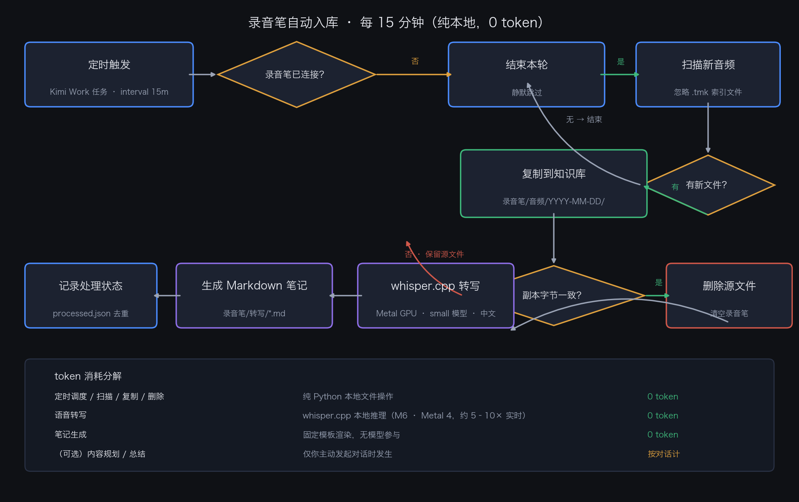

# recorder-ingest

**[中文](README.md)** | English

Auto-ingest tool for Sony IC voice recorders: plug in the recorder, and new recordings are **automatically copied to your Obsidian vault, transcribed locally into text, and then wiped from the recorder**.

Everything runs on your machine — no network calls, no cloud APIs, **zero token/credit cost**.



## What it does

On each run (manual or scheduled):

1. Checks whether the recorder is connected (`/Volumes/IC RECORDER/REC_FILE/FOLDER01`)
2. Scans for new audio files, skipping files that are still being written
3. Copies audio into the vault at `录音笔/音频/<date>/`
4. Transcribes speech locally with [whisper.cpp](https://github.com/ggml-org/whisper.cpp) (Metal GPU acceleration on Apple Silicon; Simplified Chinese output by default)
5. Generates a Markdown note in `录音笔/转写/` with frontmatter and an embedded audio link, playable directly in Obsidian
6. **After verifying the vault copy is byte-identical**, deletes the source file from the recorder

## Safety design

- **Verify before delete**: source files are only deleted when the copy exists and matches byte-for-byte; never deleted if the copy is missing or incomplete
- **Idempotent**: processed files are tracked by `filename|size` in `workspace/processed.json` — re-running never duplicates work
- **Resumable**: a failure on one file doesn't block others; the next run continues from the unfinished step
- Sony `.tmk` index files are ignored and never touched

## Installation (macOS + Apple Silicon)

```bash
git clone https://github.com/wuxiumu/recorder-ingest.git && cd recorder-ingest
./setup.sh
```

`setup.sh` installs `whisper-cpp` and `ffmpeg` via Homebrew, then downloads the whisper `small` model (~466 MB).

## Usage

### Run once manually

```bash
python3 ingest.py
```

Outputs a JSON result, e.g.:

```json
{
  "status": "ok",
  "message": "新入库 2 条录音并完成转写；已清空录音笔 2 个源文件",
  "processed": [...],
  "errors": []
}
```

### Run on a schedule

**Option A: Kimi Work automation (recommended)** — create a Python scheduled task pointing at `ingest.py` (the script already exposes a `run(ctx)` entry), every 15 min to 1 hour.

**Option B: macOS launchd (no Kimi required)**

```bash
# Edit the plist to replace __PROJECT_DIR__ with the absolute path of this project, then:
cp com.local.recorder-ingest.plist ~/Library/LaunchAgents/
launchctl load ~/Library/LaunchAgents/com.local.recorder-ingest.plist
```

Runs every 15 minutes by default; logs go to `logs/`.

### Configuration

Override defaults with environment variables — no code changes needed:

| Variable | Default | Description |
|---|---|---|
| `RECORDER_SRC` | `/Volumes/IC RECORDER/REC_FILE/FOLDER01` | Recorder directory |
| `VAULT_DIR` | `~/Documents/Obsidian Vault` | Vault root |
| `WHISPER_MODEL` | `~/Documents/kimi/models/ggml-small.bin` | Model path |

## Output structure

```
Obsidian Vault/录音笔/
├── 音频/2026-11-14/261114_0842.mp3   # audio archived by recording date
└── 转写/261114_0842.md               # transcript (embedded audio, tagged)
```

## Performance

Measured on Apple M6 / 16 GB: the `small` model transcribes at roughly 5–10× real time (a 3-minute recording takes ~20–40 s). On machines with more memory, switch to `ggml-medium.bin` in `setup.sh` for better Chinese accuracy.

## FAQ

**Transcripts come out in Traditional Chinese?** The script already steers output to Simplified via `--prompt`; occasional Traditional characters may still appear — the `medium` model improves this.

**Want to keep files on the recorder?** Remove the two `delete_source(...)` calls in `run()`.

**Other recorder brands?** As long as the device mounts as a folder of common audio files on macOS, just point `RECORDER_SRC` at it.

## License

MIT
