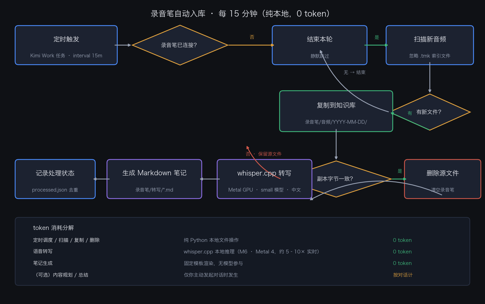

# recorder-ingest

**[English](README.en.md)** | 中文

索尼 IC 录音笔自动入库工具：插上录音笔，新录音会**自动复制到 Obsidian 知识库、本地转写成文字稿，然后清空录音笔**。

全程在本机运行，不联网、不调用云端 API、**零 token 消耗**。



## 它做什么

每次运行（手动或定时）：

1. 检查录音笔是否连接（`/Volumes/IC RECORDER/REC_FILE/FOLDER01`）
2. 扫描新音频文件，跳过还在写入的文件
3. 复制音频到知识库 `录音笔/音频/<日期>/`
4. 用 [whisper.cpp](https://github.com/ggml-org/whisper.cpp) 在本机把语音转成简体中文文字（Apple Silicon 走 Metal GPU 加速）
5. 生成 Markdown 笔记到 `录音笔/转写/`，带 frontmatter 并内嵌音频，Obsidian 里可直接播放对照
6. **确认知识库副本字节完整后**，删除录音笔里的源文件

## 安全设计

- **先验证后删除**：只有副本字节数与源文件完全一致才删除；副本缺失或不完整时绝不删除
- **幂等**：以「文件名|字节数」记录处理状态（`workspace/processed.json`），重复运行不会重复复制或转写
- **断点续跑**：某个文件失败只影响它自己，下轮自动从未完成的步骤继续
- 索尼的 `.tmk` 索引文件会被忽略，不会误删

## 安装（macOS + Apple Silicon）

```bash
git clone https://github.com/wuxiumu/recorder-ingest.git && cd recorder-ingest
./setup.sh
```

`setup.sh` 会做两件事：安装 `whisper-cpp` 和 `ffmpeg`（通过 Homebrew），下载 whisper small 中文模型（约 466MB，优先用国内镜像）。

## 使用

### 手动运行一次

```bash
python3 ingest.py
```

输出 JSON 结果，例如：

```json
{
  "status": "ok",
  "message": "新入库 2 条录音并完成转写；已清空录音笔 2 个源文件",
  "processed": [...],
  "errors": []
}
```

### 定时自动运行

**方式一：Kimi Work 定时任务（推荐，本项目正在使用的方式）**

在 Kimi Work 里创建一个 Python 定时任务，入口指向 `ingest.py`（脚本已带 `run(ctx)` 入口），间隔 15 分钟–1 小时即可。

**方式二：macOS launchd（不依赖 Kimi Work）**

```bash
# 编辑 plist 里的路径为你本机的实际路径，然后：
cp com.local.recorder-ingest.plist ~/Library/LaunchAgents/
launchctl load ~/Library/LaunchAgents/com.local.recorder-ingest.plist
```

默认每 15 分钟运行一次，日志写在 `logs/` 下。

### 自定义配置

用环境变量覆盖默认值，无需改代码：

| 环境变量 | 默认值 | 说明 |
|---|---|---|
| `RECORDER_SRC` | `/Volumes/IC RECORDER/REC_FILE/FOLDER01` | 录音笔目录 |
| `VAULT_DIR` | `~/Documents/Obsidian Vault` | 知识库根目录 |
| `WHISPER_MODEL` | `~/Documents/kimi/models/ggml-small.bin` | 模型路径 |

## 产出结构

```
Obsidian Vault/录音笔/
├── 音频/2026-11-14/261114_0842.mp3   # 按录音日期归档的音频
└── 转写/261114_0842.md               # 文字稿（内嵌音频、带标签）
```

## 性能参考

Apple M6 / 16GB 实测：small 模型约 5–10 倍实时速度（3 分钟录音 ≈ 20–40 秒转写）。内存更大的机器可在 `setup.sh` 里把模型换成 `ggml-medium.bin`，中文准确率更高。

## 常见问题

**转写出现繁体字？** 脚本已用 `--prompt` 引导简体中文；个别字仍可能转繁，换 medium 模型可改善。

**想保留录音笔里的文件？** 把 `run()` 里两处 `delete_source(...)` 调用删掉即可。

**支持别的录音笔？** 只要插上 Mac 后是一个目录、里面是常见音频格式，改 `RECORDER_SRC` 就能用。
